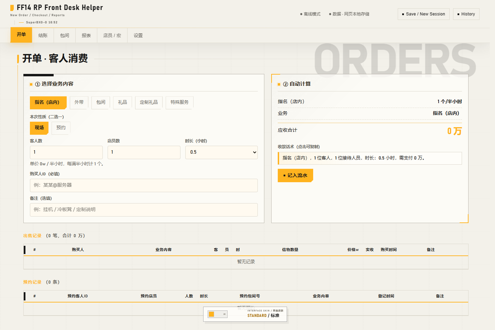
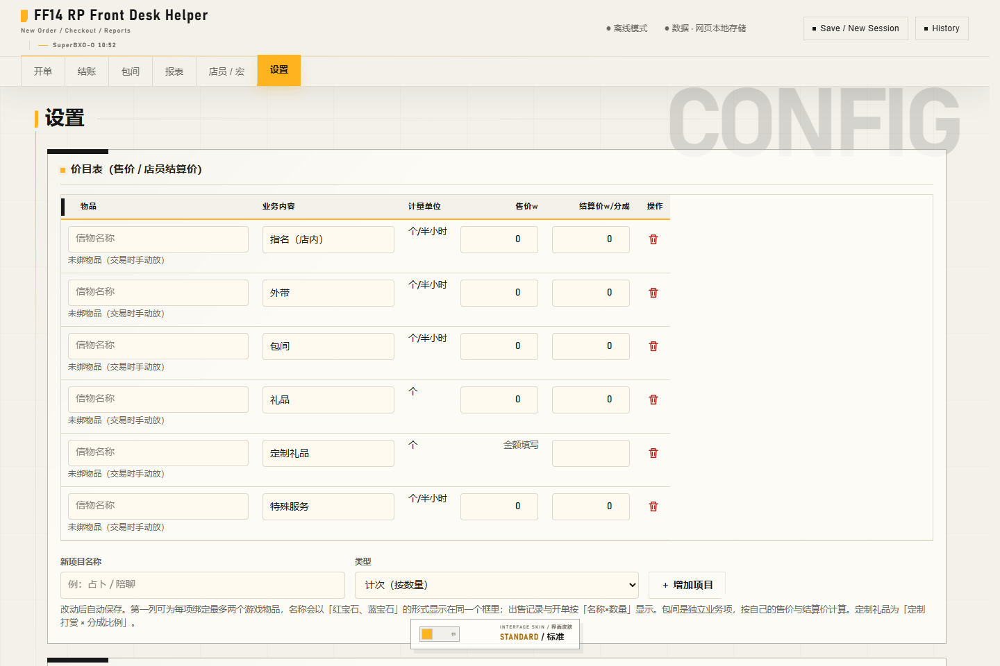
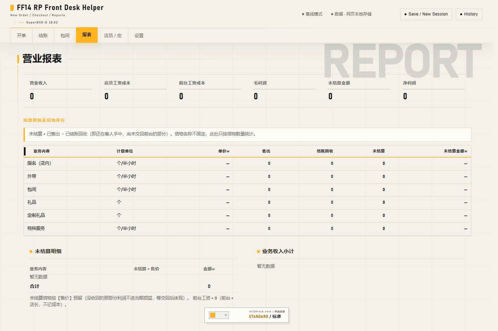
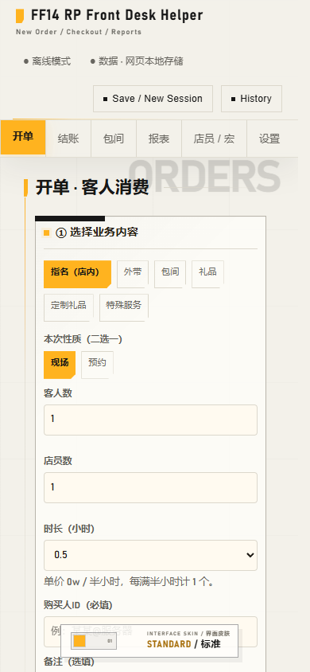

# FF14 RP Front Desk Helper

An open-source, browser-based front desk and bookkeeping tool for Final Fantasy XIV role-play venues.

The app runs as a single static `public/index.html` file. It works offline using browser storage, and can connect to the separately distributed [INPA Bridge](https://github.com/SuperBXO-O/INPABridge) plugin through `127.0.0.1:18500` for in-game integration.

This project is not affiliated with or endorsed by Square Enix, Final Fantasy XIV, DeepSeek, or any third-party skill author. It does not include official game artwork, logos, fonts, screenshots, or text.

## Screenshots

### Orders and automatic calculation



### Settings



### Report



### Mobile layout



## Features

- Business items with configurable names, prices, staff settlement rates and units
- Customer orders, reservations, room usage and settlement records
- Inventory reconciliation and business reports
- Browser-local data plus optional shared data through INPA Bridge
- Session archive export to JSON and XLSX
- Up to three game-item bindings per business item
- In-game tell tickets, customer chat, ignore list and whitelist
- Optional separate front desk and staff salary allocation modes
- Responsive desktop and mobile layouts
- Historical sale prices and wage rates are frozen with each posted record
- Sales and settlements can be voided or refunded without deleting the voucher
- Concurrent sales and settlements from multiple windows are merged safely
- Over-returned tokens remain allowed, appear as reconciliation exceptions, and affect profit through their recorded wage cost

## Deployment

Use Browsingway to display the front desk page inside the game. Install INPA Bridge as well if you need target selection, private messages, item binding, automated trading, or shared data.

### Install the in-game components

1. Open `/xlplugins` and install **Browsingway**.
2. Install **INPA Bridge**. If it is not listed, open **Experimental → Custom Plugin Repositories** in `/xlsettings` and add:

```text
https://raw.githubusercontent.com/SuperBXO-O/INPABridge/main/repo.json
```

3. Return to `/xlplugins` and confirm that both Browsingway and INPA Bridge are enabled.

Browsingway displays the web page inside the game. INPA Bridge provides target reading, inventory access, trading, shared data, and the local page service.

### Create a Browsingway inlay

INPA Bridge does not bundle the front desk web page. Download `public/index.html` from this repository and place it in the current INPA Bridge plugin directory:

```text
%APPDATA%\XIVLauncher\installedPlugins\INPABridge\<version>\index.html
```

For portable XIVLauncher installations, replace `%APPDATA%\XIVLauncher` with the launcher's data directory. The page file must be named `index.html` or `app.html`.

Alternatively, place the page in a stable folder outside the plugin version directory and create a `page.txt` file beside the INPA Bridge DLL. Enter the absolute path to the page file or its containing folder:

```text
D:\path\to\FF14-RP-Front-Desk-Helper\public\index.html
```

INPA Bridge updates install into a new version directory. After an update, place `index.html` in the new plugin directory again or recreate `page.txt`.

Before configuring Browsingway, open `http://127.0.0.1:18500` in a local browser and confirm that the front desk page appears.

Open Browsingway with `/bw` or from the Dalamud plugin settings, then create a new inlay:

- **Name**: `ff14rpfrontdeskhelper`
- **URL**: `http://127.0.0.1:18500`
- **Zoom**: start with `100%`
- **Opacity**: adjust as needed; `95%` is a common starting point
- **Framerate**: `60 FPS` is recommended

The URL is the local page address provided by INPA Bridge. It is not the GitHub project URL or the INPA Bridge repository URL.

After entering the game, resize and position the inlay. Once it is displayed correctly, lock the window with:

```text
/inpalock
```

Run the same command again to unlock it.

### Connect to INPA Bridge

When `http://127.0.0.1:18500` is used as the Browsingway URL, the page and INPA Bridge use the same local service. The access token is injected by the plugin, so manual entry is normally unnecessary.

| Command | Action |
|---|---|
| `/inpa` | Show or hide the front desk window |
| `/inpareload` | Reload the in-game front desk page |
| `/inpalock` | Lock or unlock the window position |
| `/inpacal` | Adjust the input overlay position and size |

Once the page shows an online connection, target selection, trading, and shared data features are available.

### Troubleshooting

- **Blank inlay**: Confirm that the URL is `http://127.0.0.1:18500` and that INPA Bridge is enabled.
- **Cannot connect to the plugin**: Confirm that INPA Bridge is running and that port `18500` is not in use by another application.
- **Page shows offline**: Run `/inpareload` and check the connection indicator again.
- **Chinese input does not work**: Click the input field and use the INPA Bridge input overlay. Run `/inpacal` if the overlay position is incorrect.
- **Cannot find the window**: Run `/inpa` to toggle visibility, then use `/inpalock` to unlock and reposition it.
- **Window hides immediately**: Check whether Browsingway has hide-out-of-combat, hide-after-combat, or similar options enabled.
- **Changes do not appear**: Run `/inpareload`.
- **Page address stops working after an INPA Bridge update**: Restart the game and run `/inpa` again, then confirm that the Browsingway URL has not changed.

## Data and privacy

- The repository contains no player identifiers or business records.
- Browser-only mode keeps records in the browser.
- Plugin mode stores data on the user's own computer.
- Network access is only used for pages, plugin requests and optional calendar/music embeds already declared by the interface.

## Design and AI disclosure

The product was developed through an iterative human-directed design process with AI assistance. DeepSeek was used during product design, interface exploration, copy iteration and implementation support. Generated output was reviewed, edited and tested before being included.

See [DESIGN.md](DESIGN.md) for the design process and [THIRD-PARTY-NOTICES.md](THIRD-PARTY-NOTICES.md) for development references and upstream licenses.

## License

This project is licensed under the **GNU Affero General Public License v3.0**. See [LICENSE](LICENSE).

If you modify this program and make it available to users over a network, the AGPL requires that those users can obtain the corresponding source code.

The project name and branding identify this upstream project. The AGPL does not grant trademark rights or permission to represent a modified deployment as an official release.

## Contributing

Contributions are welcome. Read [CONTRIBUTING.md](CONTRIBUTING.md) before submitting changes.

